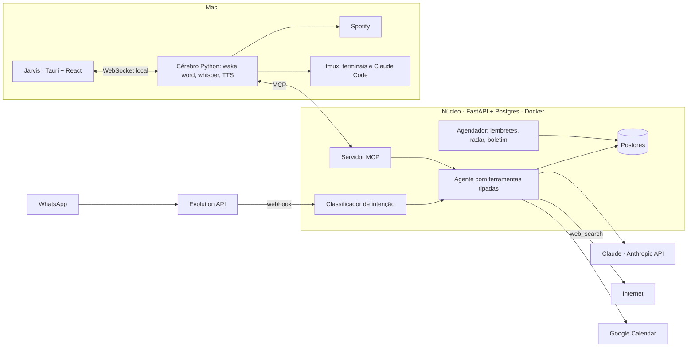

# life-manager

Assistente pessoal com agente LLM, avaliação automatizada e custo medido. Um núcleo em Python atende pelo **WhatsApp** e pelo **Jarvis**, um app de voz para o Mac, com as mesmas ferramentas. Em uso real, todos os dias, por uma pessoa: o autor.

[](https://github.com/kaiox21/life-manager/actions/workflows/ci.yml)

Não é um produto. É um sistema de usuário único, e o repositório existe para mostrar **como** ele foi construído: especificações com cenários, decisões com o porquê, uma prova que roda contra o modelo real e um registro de custo por mensagem.

## O que ele faz

| Você diz (ou acontece) | O que o sistema faz |
| --- | --- |
| "gastei 47 no almoço no Nubank" | Lança a despesa (valor em centavos, categoria, cartão, data) e ecoa o que gravou |
| (foto de um cupom ou print de Pix) | Extrai estabelecimento, valor e data; pede confirmação antes de gravar |
| "total da fatura do Nubank de novembro" | Soma em SQL os lançamentos daquele ciclo de fatura (a regra de fechamento vive no código) |
| "coloque na agenda a prova de direito, 14 de março às 19h" | Cria o evento no banco e no Google Calendar; avisa antes, pelo WhatsApp |
| "Hey Jarvis" | O painel abre e ele fala o resumo do dia: clima, compromissos, faturas e as 3 manchetes |
| "Jarvis, toca Legião Urbana" | Toca no Spotify e abaixa a música enquanto ouve e responde |
| "Jarvis, o que o STF decidiu hoje sobre…" | Pesquisa na internet e responde com as fontes num cartão |
| todo dia, 07:30 | Boletim de notícias dos temas do dono (e futebol), com link verificado, no WhatsApp e no painel |
| a cada 3 dias | Radar de vagas (estágio, bolsa, júnior) com link verificado; "não tenho interesse na V12" esconde uma |
| toda janela nova do Terminal | Aparece como aba no painel do Jarvis; ele manda mensagens ao Claude Code com um cartão de confirmação |

## Arquitetura



- **Só `app/channel/` conhece o WhatsApp.** O resto recebe e devolve tipos próprios; trocar a Evolution API pela API oficial não toca o agente.
- **O LLM só toca o banco pelas ferramentas** de `app/agent/tools/`, e recebe só as do grupo da intenção classificada.
- **O Jarvis é um cliente MCP do núcleo.** Se o Docker está fora, o painel segue com os dados locais (clima, Mac, música) e reconecta sozinho.

## Números

- **533 testes** unitários que rodam sem rede e sem LLM, contra um Postgres descartável; 64 testes da interface.
- **56 casos na prova do agente** (`tests/eval/casos.yaml`): mensagens reais com a chamada de ferramenta esperada, rodadas contra o modelo real. Última: 56/56 no classificador, 55/56 no agente, US$ 0,02.
- **16 capacidades especificadas** com cenários em `openspec/specs/`, 8 mudanças arquivadas e as decisões em `SPEC.md`.
- **Custo medido, não estimado:** toda mensagem gera uma linha em `agent_runs` com modelo, tokens, custo, latência e ferramentas. Na primeira semana, 71 rodadas custaram US$ 0,19. O boletim diário custa ~US$ 0,08 por edição (8 buscas); o total fica perto de US$ 3 por mês.

## Cinco decisões, e o porquê

1. **O modelo escolhe a ferramenta; o código faz as contas.** Dinheiro é `int` em centavos, somas são SQL, e a regra da fatura (fechamento, vencimento, virada de ano, parcelas) vive em `app/domain/billing.py` com testes. Argumentos inválidos voltam ao modelo uma vez; dois fracassos escalam para um modelo maior. Um LLM que soma é um bug esperando a hora.
2. **A prova compara só a primeira chamada de ferramenta.** Comparar texto de resposta é frágil; comparar a ferramenta e os argumentos é objetivo. O executor fixa a data, monta o banco, roda classificador e agente e imprime placar por grupo e custo. Roda antes de qualquer mudança em prompt, ferramenta ou modelo.
3. **Nenhum aviso sai duas vezes, e o Mac dormindo só atrasa.** Todo envio reserva uma linha em `sent_reminders` (chave única) antes de mandar; se falhou, a reserva é desfeita e o próximo ciclo tenta. Radar e boletim não são um cron às 07:30: são checagens periódicas que leem `agent_runs` e decidem sozinhas se é hora, com teto de tentativas por dia.
4. **Da internet só entra o que a busca devolveu.** Um link só é aceito se apareceu nos resultados daquela rodada; a fonte sai do domínio do link, não do texto do modelo; o título tem que bater com a página; o mesmo fato não volta em 3 dias. Na primeira rodada real, o modelo pôs o fato de uma notícia no link de outra, e esse filtro nasceu daí.
5. **A palavra de ativação passa por duas portas.** O detector local (sherpa-onnx) só roda quando o VAD diz que há fala, e o painel só abre depois que a transcrição confirma o nome. Nada de áudio sai do Mac para ouvir. Os ajustes foram medidos, não chutados: 66% → 88% de detecção em vozes sintéticas, e a voz "craquelada" acabou sendo 36 a 76 *underruns* por frase, zerados com uma thread de áudio.

Mais decisões, riscos e o que ficou em aberto: [`SPEC.md`](SPEC.md). Como o projeto é construído, com os erros que o processo pegou: [`docs/como-foi-feito.md`](docs/como-foi-feito.md).

## Rodar

```bash
cp .env.example .env                                 # chaves e números ficam só aqui
docker compose up -d                                 # evolution-api, postgres, redis, app
docker compose --profile test up -d postgres-test    # banco descartável dos testes
uv sync && uv run pytest                             # sem rede, sem LLM
uv run pytest -m eval                                # a prova (custa centavos)
cd jarvis-ui && npm ci && npm test                   # interface
```

Jarvis no Mac: `uv sync --extra jarvis`, `npm run tauri build -- --bundles app` em `jarvis-ui/` e `bash jarvis/install_mac.sh`. Clientes MCP: [`docs/mcp.md`](docs/mcp.md). VPS: [`deploy/`](deploy/).

## Mapa do repositório

| Onde | O quê |
| --- | --- |
| `app/` | Núcleo: canal do WhatsApp, agente e ferramentas, agenda, gastos, lembretes, radar, boletim, MCP |
| `jarvis/` | Cérebro do Jarvis: voz, palavra de ativação, resumo do dia, Spotify, terminais, cliente MCP |
| `jarvis-ui/` | App Tauri 2 + React: HUD, painel, abas de terminal |
| `openspec/specs/` | O **o quê**: requisitos e cenários de cada capacidade (fonte de verdade) |
| `openspec/changes/` | Mudanças em andamento e arquivadas: proposta, design, tarefas, deltas |
| `SPEC.md` | O **porquê**: visão, decisões, riscos, questões em aberto |
| `tests/` | Unitários (`unit/`, `jarvis/`), a prova (`eval/`) e fixtures |
| `docs/` | Como foi feito, próximos passos, MCP, histórico das fases 1 a 7 |
| `CLAUDE.md` | Regras de arquitetura e segurança que valem em toda sessão de desenvolvimento |

## Estado

Em uso diário. Aberto: calibração e aceite por voz de algumas funções, deploy num VPS. Lista com o que falta e como testar: [`docs/proximos-passos.md`](docs/proximos-passos.md).

## Autor

Kaio Xavier ([@kaiox21](https://github.com/kaiox21)). Construído em pareamento com o Claude Code; o processo, com o que é decisão humana e o que é geração, está em [`docs/como-foi-feito.md`](docs/como-foi-feito.md).
